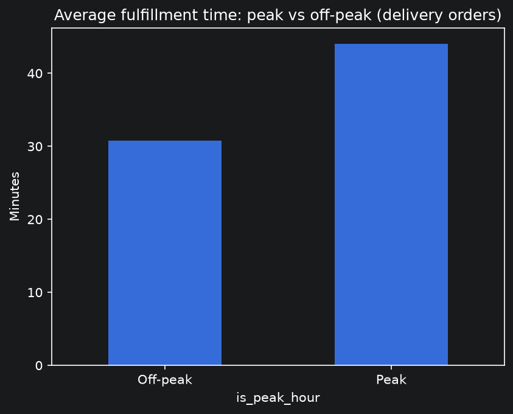
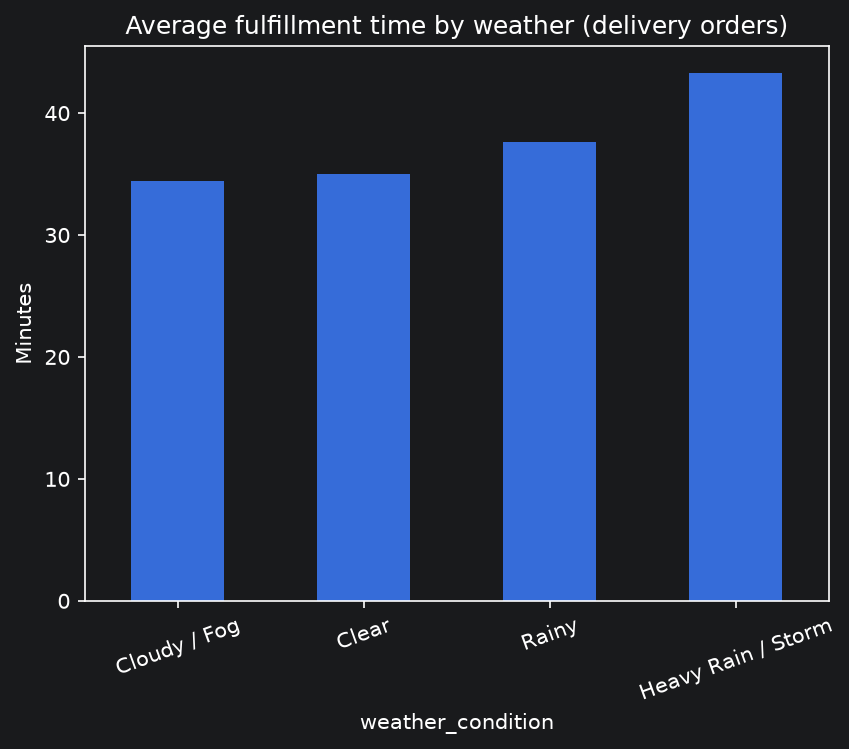
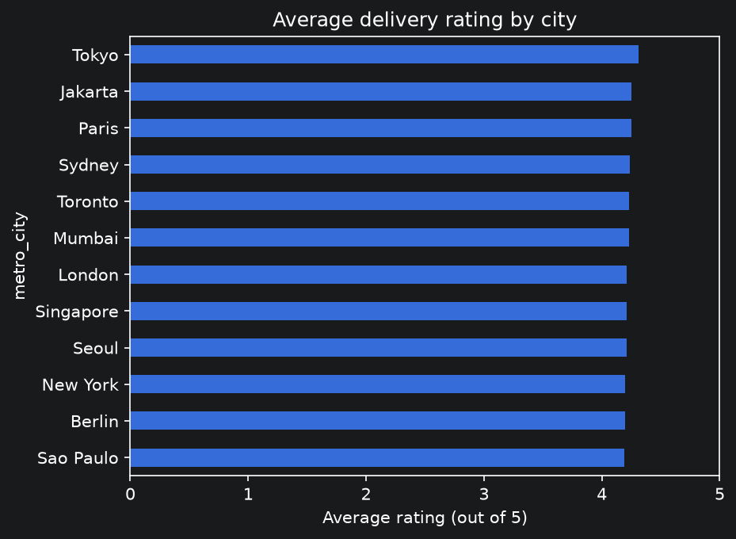
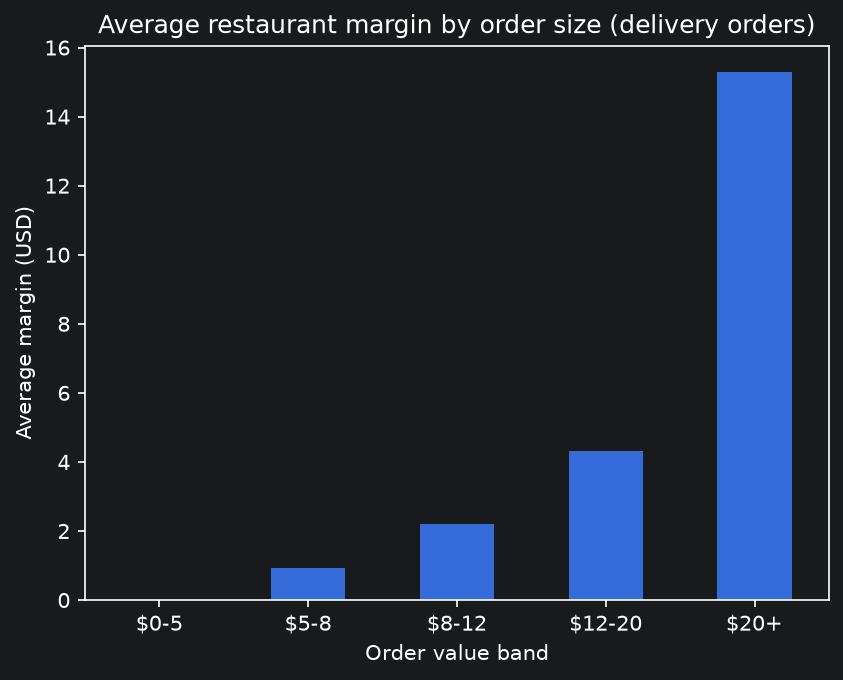

# Food Delivery Market 2026: What Drives Delivery Time, Ratings, and Restaurant Margin

I did an Exploratory data analysis of 8,000 food orders across 12 global cities, answering what slows deliveries, what customers rate poorly, and where restaurants make or lose money.

## 🔑 Key Findings
- ⏱️ **Peak hours add about 43% to delivery time:** about 44 min vs 31 min off-peak, with ratings dropping from 4.30 to 4.12.
- 🌧️ **Storms make it worse:** heavy rain orders took about 43 min vs 35 in clear weather and rated 3.86 vs 4.27. Storm plus peak hour was the worst case at about 55 min.
- 📉 **Ratings fall off a cliff after 60 minutes:** about 4.35 under 40 min, but only 3.19 above 60 min (about 8% of deliveries).
- 💸 **Discounts don't improve ratings** (correlation about 0).
- 🍽️ **Delivery earns restaurants less:** about $9.57 per order vs $13.94 for dine-in (32% of sales vs 46%), even though order size and discounts are similar.
- ⚠️ **Tiny orders lose money:** all 91 loss-making orders are delivery orders under about $4.10, where the delivery fee is larger than the food.

## 📌 Business Questions
1. Does peak hour slow deliveries?
2. How much does weather hurt delivery time and ratings?
3. What is associated with lower customer ratings?
4. Which order channel earns restaurants the most?
5. Do cities and cuisines differ?
6. Which orders lose money, and why?

## 📂 Dataset
| | |
|---|---|
| **File** | `global_food_delivery_enriched_market_2026.csv` |
| **Source** | Kaggle |
| **Size** | 8,000 orders × 26 columns |
| **Coverage** | 12 cities, 7 cuisines, 3 channels (delivery app, dine-in, takeaway) |

**Data notes**
- No missing values and no duplicate rows.
- Dine-in and takeaway orders have zero delivery distance and time, so all delivery analysis uses delivery-app orders only (5,255 orders).
- `net_effective_order_price` was verified as order value − discount + delivery fee.
- The dataset appears to be synthetic (it includes auto-generated text and a confidence score), so findings describe this data, not real markets.

## 🧰 Tools
Python · pandas · matplotlib · Jupyter Notebook

## 🔧 Process
1. **Inspect and check quality:** shape, types, missing values, duplicates, and the channel issue above
2. **Validate columns:** confirmed how the net price is calculated
3. **Analyze:** grouped comparisons, correlations, and banding (time and order size) to answer each question
4. **Check for hidden factors:** compared weather against peak hour so one wasn't blamed for the other
5. **Visualize and conclude:** one chart per question, then recommendations

## 📊 Selected Charts









<!-- After you add the missing notebook cells and create these two charts, delete this line and the closing line:


-->

## ✅ Recommendations
- Plan courier and kitchen capacity for peak hours, especially stormy peaks.
- Aim to keep deliveries under 60 minutes, and show realistic estimates in bad weather.
- Don't rely on discounts to improve satisfaction. Faster service is a better lever.
- Consider a minimum order value or small-order fee for orders under about $5 (test first, since the margin formula is not provided).

## ⚠️ Limitations
- Synthetic dataset, so results may not match real markets.
- Margin is an estimate and its formula is not given.
- "Peak hour" is not defined in the dataset.
- Correlation is not causation; time, distance, and fees are related to each other.
- City and cuisine differences are small and may be noise.

## 📁 Files
- `food_delivery_analysis.ipynb`: full analysis notebook
- `global_food_delivery_enriched_market_2026.csv`: dataset
- `*.png`: charts used above

## ▶️ How to Run
```bash
git clone https://github.com/YohanaHiruy/food-delivery-market-analysis
cd food-delivery-market-analysis
pip install pandas matplotlib jupyter
jupyter notebook food_delivery_analysis.ipynb
```

---
📫 [LinkedIn](https://www.linkedin.com/in/yohana-hiruy-55b225380) • [Email](mailto:johanhgf5@gmail.com)
